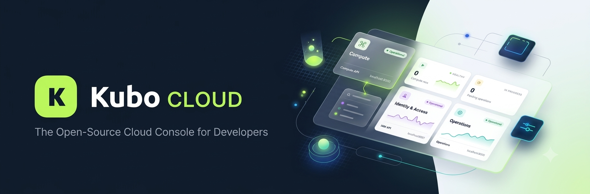

<div align="center">
  
  <h1>Kubo</h1>
  <p><strong>A self-hosted cloud console for developers.</strong></p>
  <p>Explore cloud infrastructure concepts on your own machines with Kubo's IAM and Compute services.</p>
</div>

---

Kubo is an open-source, AWS-inspired platform for managing infrastructure on your own machines. It provides native APIs and a local dashboard for experimenting with identity, organizations, and Docker-backed compute workloads.

Kubo is not a complete AWS emulator and does not promise AWS API or SDK compatibility.

## Project status

Kubo is in early development. IAM and the initial Compute API, asynchronous operation pipeline, and local dashboard are implemented. Networking integration is not yet available, so compute port mappings are not supported.

| Area | Status |
|---|---|
| IAM | Accounts, authentication, organizations, membership, and authorization APIs |
| Compute | Organization-scoped lifecycle API, durable operations, RabbitMQ publishing, and Docker worker |
| Dashboard | Local development UI for IAM and Compute |
| Networking | Not implemented; inbound port allocation and attachment are unavailable |

Compute images and profiles are operator-configured; the repository does not include built-in catalogs. Compute workloads require RabbitMQ, Docker Engine, and valid service credentials. See the [Compute API and runtime configuration](docs/architecture/compute-api.md) for current requirements and limitations.

## Dashboard

The local dashboard provides a visual way to sign in, manage organizations, and exercise the implemented Compute APIs.


### Run locally

The dashboard requires Node.js 20 or newer. Start IAM and Compute first; see the [IAM setup guide](services/iam/README.md) and [Compute runtime configuration](docs/architecture/compute-api.md).

```powershell
Set-Location C:\Kubo\frontend
npm run dev
```

Open [http://127.0.0.1:5173](http://127.0.0.1:5173). By default, the dashboard proxies requests to IAM at `127.0.0.1:8001` and Compute at `127.0.0.1:8000`. Configure alternate upstreams with `KUBO_DASHBOARD_IAM_URL` and `KUBO_DASHBOARD_COMPUTE_URL`.

The dashboard is a local development tool, not a production deployment. It keeps the user token in page memory and does not configure or modify backend services.

## Services

### IAM

The IAM service provides native Kubo accounts, authentication, organization membership, and authorization. Accounts are provisioned by an operator; public registration and invitations are not available in this implementation.

See the [IAM README](services/iam/README.md) for Windows development setup and CLI commands. Its OpenAPI documentation is available at `/docs` while the service is running.

### Compute

The Compute service exposes an asynchronous lifecycle API for organization-owned Docker workloads. It records operations durably and uses RabbitMQ to dispatch work to a separate worker process.

The Compute API, outbox publisher, and worker are separate processes. The API requires a scoped IAM service credential for authorization; the worker uses a separate credential. Actual workload execution also requires RabbitMQ, Docker Engine, valid image and profile catalogs, and a Docker host that enforces the configured resource limits. Port-bearing create requests fail safely until Networking integration is implemented.

See the [Compute API contract and runtime configuration](docs/architecture/compute-api.md) for endpoints, settings, and operational requirements.

## Development

### Requirements

- Python 3.12 or newer
- Node.js 20 or newer for the dashboard
- Docker Desktop with its WSL2/Linux-container backend for local workload execution
- RabbitMQ for asynchronous Compute work

IAM and Compute use SQLite by default for local development. PostgreSQL is supported for deployment; service-specific configuration is documented with each API.

### Run tests

Install each service's development dependencies from its directory, then run its tests:

```powershell
Set-Location C:\Kubo\services\iam
python -m pip install -e ".[dev]"
python -m pytest
```

```powershell
Set-Location C:\Kubo\services\compute
python -m pip install -e ".[dev]"
python -m pytest
```

Do not commit passwords, bearer tokens, or other credentials. Service credentials are displayed only once when created; provide them to local processes through environment variables or an appropriate secret manager.

## Architecture and API documentation

Start with the [architecture index](docs/architecture/README.md). Key documents:

| Document | Description |
|---|---|
| [System architecture](docs/architecture/system-architecture.md) | Platform boundaries and service relationships |
| [Implementation requirements](docs/architecture/architecture-requirement.md) | Initial milestone scope and constraints |
| [IAM API](docs/architecture/iam-api.md) | Accounts, organizations, and authorization |
| [Compute API](docs/architecture/compute-api.md) | Compute lifecycle, operations, and runtime configuration |
| [Networking API](docs/architecture/networking-api.md) | Planned networking contract and integration boundary |
| [Data flows](docs/architecture/data-flow.md) | Authentication and compute lifecycle flows |
| [Security architecture](docs/architecture/security-architecture.md) | Trust boundaries and required security controls |
| [Architecture decisions](docs/architecture/decisions/README.md) | Accepted architectural decisions |

## Contributing

Keep changes consistent with the documented service boundaries and accepted architecture decisions. Update relevant API or architecture documentation when behavior changes. For changes that alter an accepted decision, propose an Architecture Decision Record (ADR) alongside the implementation.
