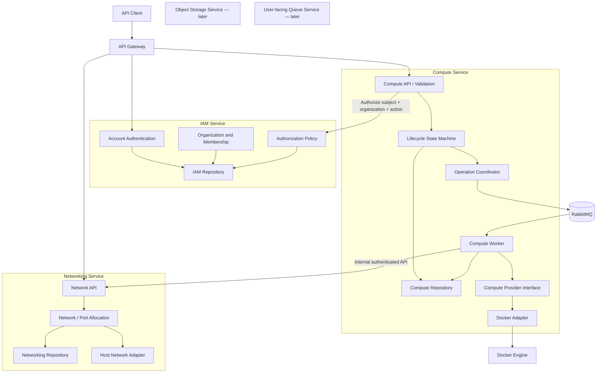

# Kubo — Component Architecture

**Document ID:** KUBO-ARCH-COMP-001  
**Version:** 1.0
**Status:** Accepted baseline

This document describes logical responsibilities inside the independently deployable first-milestone services. It does not prescribe programming languages or frameworks.

## Ownership rules

### API Gateway

- Routes external requests and applies common request-level limits and correlation identifiers.
- Does not become the only authorization boundary and does not own domain data.
- Does not expose Docker, host-network, database, or RabbitMQ administration interfaces to clients.

### IAM Service

- Owns accounts, organizations, memberships, role assignments, and authentication records.
- Establishes a trusted user identity and organization scope.
- Evaluates or supplies authorization decisions through an authenticated contract.
- Does not own compute or network resource state.

### Compute Service

- Owns compute resource metadata, desired and observed lifecycle state, operation status, and image policy.
- Validates lifecycle transitions and organization ownership before accepting work.
- Uses the Docker provider interface; the domain lifecycle does not depend on Docker-specific API behavior.
- Executes privileged Docker operations only through its isolated adapter/worker boundary.

### Networking Service

- Owns logical network configuration and address/port allocations.
- Validates organization scope and applies host-specific networking through a bounded adapter.
- Does not assume future Firecracker and Docker networking are interchangeable.

### Worker and internal messaging

- Workers act under a distinct service identity and preserve initiating-user, organization, resource, and operation attribution.
- Messages are untrusted input: consumers validate schema, operation state, and authorization context.
- Consumers are idempotent and report failures; RabbitMQ delivery alone does not establish authorization or successful completion.

Object Storage and the user-facing Queue Service are outside the first milestone and must receive independent contracts and ownership boundaries before implementation.
