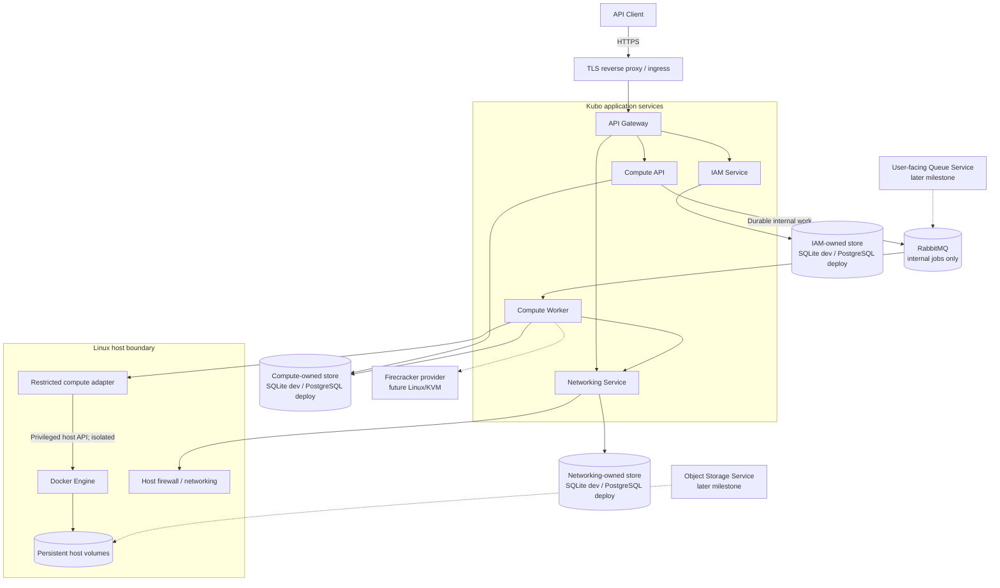

# Kubo — Container Architecture

**Document ID:** KUBO-ARCH-CNT-001  
**Version:** 1.0
**Status:** Accepted baseline

In this C4 view, a container means a deployable application or data store, not necessarily a Docker container. The selected first-milestone services are independently deployable.

## Data ownership and communication

- IAM, Compute, and Networking each own their data store and migrations.
- Services use synchronous, authenticated HTTP for bounded cross-service requests and RabbitMQ for asynchronous work.
- Services never query another service's private database.
- RabbitMQ is not the user-facing Queue Service and does not own resource state.
- The privileged Docker adapter is isolated from public API traffic. Access to the Docker Engine is a host-level trust boundary.
- The dotted components are not part of the first milestone. The user-facing Queue Service must have separate contracts, authorization, and operational policies if it later shares broker technology.
