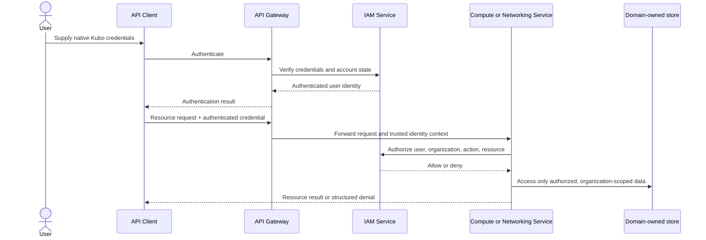
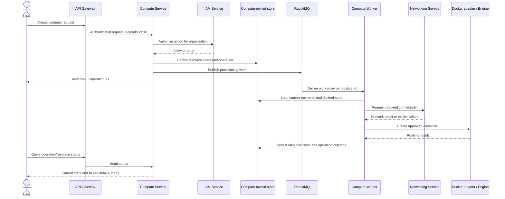

# Kubo — Data Flows

**Document ID:** KUBO-ARCH-DATA-001
**Version:** 1.0
**Status:** Accepted baseline; message schemas and API contracts are implementation deliverables

## 1. Authentication and organization authorization

Clients authenticate through the IAM API and present its one-hour opaque bearer token. IAM
stores token hashes and supports revocation; there is no refresh endpoint in this slice.
Client-supplied organization or user identifiers are never proof of access. Each resource
service enforces authorization for its own data, and internal service calls use a distinct
service identity rather than forwarding user credentials as proof of service trust.

## 2. Asynchronous compute creation

### Flow invariants

- Persist accepted operation state before acknowledging acceptance.
- The database/RabbitMQ dual-write gap must be addressed with a transactional outbox or an equivalent recoverable mechanism before the worker is relied on.
- A consumer must safely handle duplicate delivery and stale work by re-reading authoritative desired state.
- Do not acknowledge successful resource creation until Docker and required networking have succeeded and the resulting state is persisted.
- On partial failure, expose the error and run documented compensating cleanup; failed cleanup remains visible and retryable.
- Workers preserve the initiating user, organization, resource, operation, and correlation identifiers, but validate authorization context rather than trusting message fields.

## 3. Resource access and tenancy

Every resource record has an owning organization. List, get, update, and delete operations are scoped by the authorized organization before the resource is returned or mutated. An unknown identifier and an identifier owned by another organization must not disclose resource details.

For Compute, all active organization members may read resources and operations; Owners and
Admins may create, start, stop, or delete them. Networking receives internal attachment
requests from Compute and does not expose independent user-managed network CRUD in this slice.
See the [Compute API contract](compute-api.md) and
[Networking service contract](networking-api.md). Cross-service requests use authenticated
service contracts; a service does not query another service's database.

## 4. Deferred flows

Object upload/download and user-facing queue publish/receive flows are not part of the first implementation milestone. They require separate data-flow definitions, authorization rules, persistence guarantees, and failure semantics before those services are exposed.
