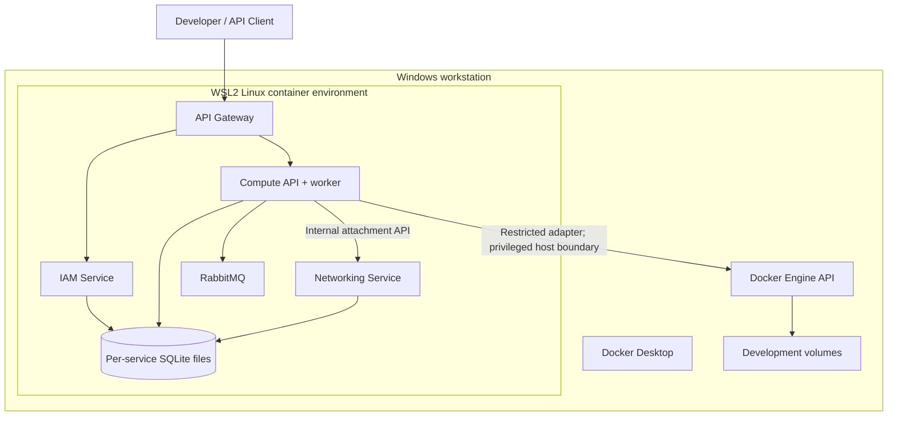
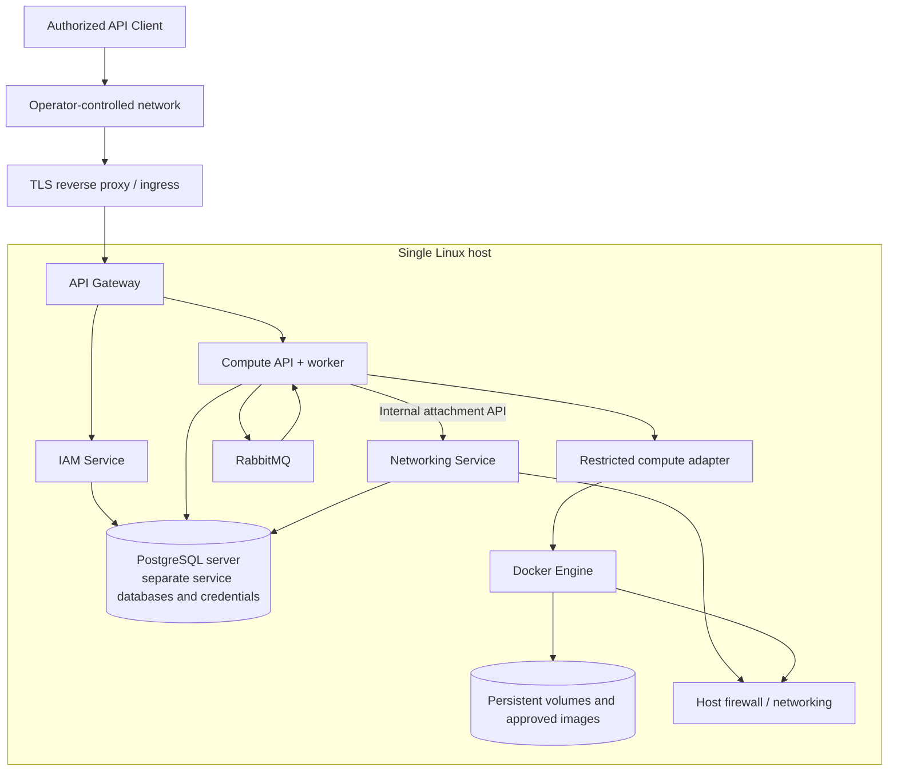

# Kubo — Deployment Architecture

**Document ID:** KUBO-ARCH-DEP-001
**Version:** 1.0
**Status:** Accepted baseline; packaging and production operations remain implementation work

## 1. Supported deployment intent

- Developers work on Windows using Docker Desktop with the WSL2/Linux-container backend.
- Self-hosted execution targets Linux.
- Firecracker is not required for either initial topology; it remains a future Linux/KVM provider.
- The first deployment is a single-host installation, not a high-availability cluster.

The exact Linux distributions, application packaging/orchestration, and resource sizing must be selected and documented during implementation.

## 2. Windows development topology

The developer machine and its Docker Engine are trusted. Docker API access is host-level privilege; it must be restricted to the compute adapter and must never be exposed to the API client or mounted into unrelated services.

## 3. Self-hosted Linux topology

## 4. Persistence and trust boundaries

- Persist PostgreSQL data, RabbitMQ state required for durable work, service configuration, and Docker-managed workload data on operator-controlled storage.
- Each service uses its own database/schema and least-privilege database credentials. Shared database-server infrastructure does not permit cross-service table access.
- RabbitMQ is internal-only and is not exposed as the user-facing Queue Service.
- TLS termination, firewall policy, backup schedule, restore testing, log retention, and secret injection must be defined by the installation procedure before a production deployment is claimed.
- Only the compute adapter receives Docker Engine access. Docker Engine access can grant host-level control; process separation alone does not remove that risk.
- A single host and single broker/database instance are single points of failure. High availability is not a first-release guarantee.

## 5. Configuration and secrets

Environment-specific configuration must be supplied at deployment time, not committed as secrets. The implementation must provide a documented mechanism for creating the initial administrator without shipping default credentials. Database, RabbitMQ, signing/session, and service credentials require restricted access and a rotation procedure.
