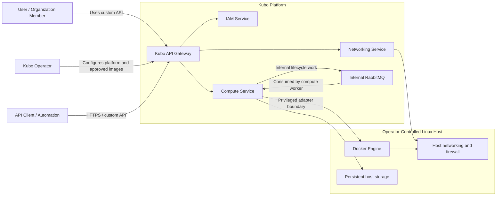

# Kubo — System Context

**Document ID:** KUBO-ARCH-CTX-001  
**Version:** 1.0
**Status:** Accepted baseline

## Purpose

This view shows Kubo's users, API clients, system boundary, and infrastructure that Kubo operates. It does not show internal service deployment.

The first milestone has no management console. Users and administrators use the custom API and its documented client interfaces. Object Storage, the user-facing Queue Service, and Firecracker are later capabilities.

Kubo does not promise AWS API compatibility. Organization authorization is enforced by Kubo services; the host operator remains trusted to administer the Linux host and Docker Engine.
